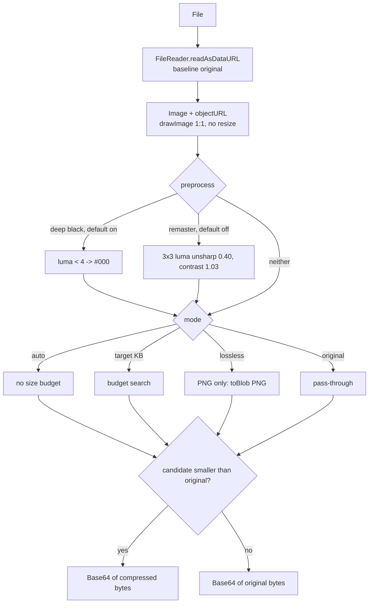

# Image to Base64 (Notification Forge): compression analysis and what to adapt

Status: analysis complete, 2026-10-23. Nothing here is implemented.
Scope: the deployed tool at `notification-forge.mrlf-synaptode.workers.dev/image-to-base64`, compared against
`frontend/tools/compress-image/`. Read `docs/compress-image-optimization-plan.md` first; this report does not repeat
that plan, it adds the one technique the plan defers.

## Question

The deployed tool advertises "Lossy Compression … with adaptive palette and smooth dithering" and
"TinyPNG-style adaptive compression". What does it actually do, and which parts are worth porting into our
compressor?

## Evidence and method

| Item                     | Value                                                                                    |
| ------------------------ | ---------------------------------------------------------------------------------------- |
| Route → component chunk  | `main-N6HRUKF3.js` route table → `chunk-33TG6M3V.js`                                     |
| Component chunk identity | sha256 `5df37533aec48427d55600a64a0d1bdc42294aac514803666c501ce143b92039`, 158 635 bytes |
| Bundle capture           | `ev_5e266d0a…` (`analyze_web_bundle`, 59 scripts, 0 parse failures)                      |
| Rendered UI + i18n       | `ev_4e2e3792…` (`capture_browser_scenario`, DOM + `assets/i18n/en.json`)                 |
| Source read              | Chunk fetched from the deployment; byte count matches the capture exactly                |

Method: static analysis of the shipped JavaScript (REA bundle capture, then direct reads of the route chunk) plus
one rendered-page capture for UI strings. **No compression was executed** — the capture path has no file-input
action, so every number below is a code constant, not a measurement.

Evidence type per claim: function bodies are observed; cost estimates are marked `[inference]`.

## What it actually does

Everything is client-side. There is no upload and no server codec: the file is decoded into a `<canvas>`, re-encoded
with either the canvas encoder or UPNG.js, and the resulting bytes become the Base64 output. The chunk bundles
**UPNG.js + pako** (UPNG's UMD shim, `window.UPNG`, is still in the source), not a compression library like
`browser-image-compression`.

The Base64 comes from the compressed `Blob` via `readAsDataURL` (`te`). `includePrefix` (default on) decides
whether the `data:image/…;base64,` header is kept, and `On` wraps the result as plain text, ``,
CSS `background-image`, or Markdown.



Mode selection is a boolean resolver (`Ua`), not a preset table:

- lossy on → auto ? `auto` : targetKB > 0 ? `target` : lossless ? `lossless` : `original`
- lossy off → lossless ? `lossless` : `original`

Defaults: `lossy = true`, `auto = true`, `lossless = true`, `remaster = false`, `deepBlack = true`,
`jpegFallback = false`, `targetSizePercent = 25`.

### Per-mode encoding

| Mode     | Function    | PNG                                                                                                                                  | JPEG / WebP                             | Other `image/*`                                                                |
| -------- | ----------- | ------------------------------------------------------------------------------------------------------------------------------------ | --------------------------------------- | ------------------------------------------------------------------------------ |
| Auto     | `Ya` → `Fl` | `Nl`: UPNG lossless, then dithered palettes 256/192/128, stop when mean colour error grows >15%                                      | `toBlob(type, 0.82)`                    | `toBlob(type)`, accepted only if the browser returns that type, else JPEG 0.82 |
| Target   | `ja` → `Rl` | `Hl`: UPNG lossless, then palette ladder **256,192,128,96,64,48,32,16** (custom dither), then UPNG native palette at the same ladder | 8-step binary search, quality 0.05–0.98 | single `toBlob(type)`; JPEG search if over                                     |
| Lossless | `Ka` → `Ll` | `toBlob('image/png')`, canvas re-encode                                                                                              | untouched                               | untouched                                                                      |
| Original | —           | untouched                                                                                                                            | untouched                               | untouched                                                                      |

Acceptance is always `Ga`: use the candidate only when `candidate.size < original.size`, otherwise keep the
original and report `optimized: false`. There is no quality floor in any mode; the only lower bound is the search
range's 0.05.

### Palette path detail

`Ln` builds a palette with `UPNG.quantize` and then applies its own serpentine Floyd–Steinberg dithering:

- 32³ nearest-colour lookup table, error weights 7/16, 3/16, 5/16, 1/16;
- error damping 0.88, dropping to 0.75 where luma < 20;
- separate alpha-error diffusion;
- transparent pixels handled as a second error channel.

Target mode additionally re-encodes the same ladder through UPNG's own quantizer (`encode(..., colors)`) and keeps
whichever candidate is smaller — an ad-hoc two-quantizer ensemble.

### JPEG fallback ("Option B")

Only reachable when the user enables it and the source has no alpha (`if (r && !n)`):
flatten onto white (`Dn`), JPEG at 0.82 in auto mode, or the same quality search as the target in target mode.

Formats outside PNG/JPEG/WebP (GIF, BMP, TIFF, ICO) take the generic branch: `toBlob(type)` with the _source_
type, accepted only when the browser returns that same type. A canvas cannot encode GIF/BMP/TIFF, so it returns
PNG, the `type === source` check fails, and the dispatcher falls through to JPEG 0.82. A GIF therefore loses
animation and becomes a single-frame JPEG whenever that is smaller. The same guard means an SVG upload re-encodes
through the canvas (rasterised at natural size) rather than being passed through.

## Behaviours worth knowing (and not copying)

| Behaviour                      | Detail                                                                                                    |
| ------------------------------ | --------------------------------------------------------------------------------------------------------- |
| No resizing anywhere           | every canvas is `naturalWidth × naturalHeight`; savings come only from palette or quality                 |
| Lossy off disables Target Size | the resolver returns `lossless`/`original` without consulting `targetKb`; the UI note claims the opposite |
| Two sources of target state    | `targetSizePercent` (25) and `targetSizeKb` (null) are kept in sync by hand and drift when auto toggles   |
| Fixed 0.82                     | auto-mode JPEG/WebP quality is a constant; no measurement, no floor                                       |
| Canvas PNG "lossless"          | re-encodes pixels and drops ancillary chunks; no metadata or ICC comparison                               |
| Main-thread encoding           | UPNG quantize/encode is synchronous JS; no Worker, no OffscreenCanvas, no `createImageBitmap`             |
| Format/name drift              | `mimeType` follows produced bytes, the file name keeps the source extension                               |
| Auto mode is not adaptive      | no size budget, no floor, no resize; "TinyPNG-style" describes the palette step only                      |

## Comparison with our compressor

| Capability       | Image to Base64                                     | `frontend/tools/compress-image`                                |
| ---------------- | --------------------------------------------------- | -------------------------------------------------------------- |
| JPEG encoder     | canvas (`toBlob`)                                   | MozJPEG wasm, progressive, optimize_coding                     |
| WebP encoder     | canvas                                              | libwebp wasm, method per preset                                |
| PNG lossless     | UPNG / canvas re-encode                             | Oxipng in place, metadata and ICC verified                     |
| PNG lossy        | hand-rolled palette + Floyd–Steinberg               | libimagequant (quality floor, `maxColors`) → Oxipng            |
| Quality control  | presets only (`0.82`), no floor                     | per-preset quality + PNG min/target quality                    |
| Size budget      | **binary search / palette ladder**                  | **none**                                                       |
| Resize           | none                                                | `fitDimensions`, optional                                      |
| Preprocessing    | deep-black clamp, unsharp                           | none                                                           |
| Candidate policy | smallest wins                                       | `selectCandidate`: 1% / 1 KB minimum saving vs best baseline   |
| Execution        | main thread                                         | worker (+ worker pool planned)                                 |
| Integrity        | size-only guard, no metadata or format verification | dimension/type checks, `verifyPngMetadata`, corrupt-zlib guard |

The technology gap runs the other way: our codecs and guards are stronger. The one structural idea we lack is
**encoding against a byte budget**.

## What to adapt

Ranked by value. Nothing here needs a new dependency.

### A. Target-size mode (recommended)

This is the deferred item "Choosing quality per image (binary search … against an SSIM or butteraugli target)" in
`docs/compress-image-optimization-plan.md`, but simpler and more useful: budget in **bytes**, quality floor from the
preset. NF proves the search shape works; it lacks the floor and the escape hatch.

**A1. JPEG/WebP — binary search on quality.** In `worker.js`, add

```js
async function encodeToTarget(encode, image, settings, targetBytes, floor, probes = 7) {
  let lo = floor;
  let hi = 100;
  let best = null; // largest quality that met the budget
  let smallest = null; // smallest output seen
  for (let i = 0; i < probes && lo <= hi; i += 1) {
    const quality = Math.round((lo + hi) / 2);
    const bytes = new Uint8Array(await encode(image, { ...settings, quality }));
    const candidate = { bytes, quality };
    if (!smallest || bytes.length < smallest.bytes.length) smallest = candidate;
    if (bytes.length <= targetBytes) {
      best = candidate;
      lo = quality + 1;
    } else {
      hi = quality - 1;
    }
  }
  return best ?? smallest;
}
```

Differences from NF's `ea`: a real floor (`PRESETS[p].quantize.quality.min` for PNG, and a new per-preset
`target.floor` for JPEG/WebP), and an explicit return of the smallest probe so the caller can decide.
Monotonicity of output size against quality is assumed, as in NF; mozjpeg is monotone in practice `[inference]`.

**A2. PNG — palette ladder.** Walk `maxColors = 256,192,128,96,64,48,32,16` through the existing `quantize()` in
`worker.js`, Oxipng each result, stop at the first that meets the budget; keep the lossless `optimizePng` result as
the baseline and fall back to the best-quality rung if none fits. NF's 15% error band is replaced by our existing
`quantize.quality.min` floor, which is absolute rather than relative.

**A3. Escape hatch NF does not have.** When the floor cannot reach the budget, scale by 0.85× via `fitDimensions`
(`service.js`) and rerun A1/A2, at most three rounds. Target mode without a resize path is why NF cannot hit small
budgets on dense photos.

**A4. Policy changes in `config.js`.**

- `selectCandidate`'s `minimumSavings` must be bypassed when the user explicitly asked for a target, otherwise
  "target 500 KB" on a 510 KB file silently returns 510 KB. Keep "never larger than original".
- Report `achievedBytes`, `probes`, `finalQuality`, `resizedTo`, and reuse the existing `fallbackReason` field when
  the floor is unreachable.

**A5. UI.** Add "Target size (KB)" next to the quality slider in `main.js` (settings block around lines 41–53,
validation around 164–191). Presets stay; target mode overrides the quality slider for JPEG/WebP and the PNG
minimum stays as the floor.

**Cost.** 6–7 encodes per image instead of 1. With the planned pool this parallelises across files, not within a
file; keep `probes` at 7 and abort through the existing `generation` check when the batch is cleared `[inference:
~0.1–0.2 s per 5 MP mozjpeg probe on the benchmark machine]`.

### B. Candidate race, not just a ladder

NF compares PNG-palette against JPEG and keeps the smaller. We already compare lossy PNG against the lossless
baseline; we never compare across codecs.

- Race the source type against WebP when a new "allow format change" toggle is on; PNG with alpha must never go to
  JPEG (NF's one good guard: `if (r && !n)`), and WebP keeps alpha.
- Every candidate still passes the dimension and type checks; PNG candidates still pass `verifyPngMetadata`. NF
  does neither.
- Extend `selectCandidate` to an N-candidate form that returns the winner and the reason; keep the 1% / 1 KB rule
  for automatic mode.

### C. Preprocessors (not recommended as-is)

NF's `Pn` forces every pixel with luma < 4 to pure `#000`; `An` applies a 3×3 luma unsharp mask (amount 0.40,
contrast 1.03). Both mutate pixels before encoding and are invisible in the UI's option descriptions beyond
marketing copy.

For our workloads (flat-colour ad cards, text, UI assets) the clamp is a no-op on already-black pixels and
destructive on dark gradients; sharpening adds ringing next to text. Recommendation: do not port. If a need appears,
gate it behind an off-by-default "enhance photo" toggle and require a benchmark win on `bench-images/` first.

### D. Data-URI output (cheap)

NF's `On` wraps the Base64 in plain text, ``, CSS `background-image`, or Markdown, with an optional
`data:` prefix. Our compressor has the same blob and our `base64-tools` already exposes the wrappers. Adding
"Copy as data URI" to a compressor row is a few lines and removes a round trip through another tool — useful for
the email/template builders.

## Do not port

| Item                                            | Why                                                                        |
| ----------------------------------------------- | -------------------------------------------------------------------------- |
| Canvas `toBlob('image/png')` as "lossless"      | drops ancillary chunks/ICC; our Oxipng path preserves and verifies them    |
| UPNG + hand-rolled dithering                    | libimagequant already dithers with a perceptual metric and a quality floor |
| Fixed 0.82 quality                              | unmeasured; we have presets and (after A) a search                         |
| Main-thread encode                              | our worker/pool plan exists precisely to avoid this                        |
| `targetSizePercent` + `targetSizeKb` dual state | drifts; use one derived value                                              |
| Lossy-off ignoring target                       | resolver quirk; keep target independent of other toggles                   |
| MIME/extension drift                            | breaks downstream consumers and our type checks                            |
| JPEG fallback by default                        | alpha flattening is silent data loss; keep opt-in and alpha-guarded        |

## Verification plan

Tests first, per the ground rules in `docs/compress-image-optimization-plan.md`.

1. **Vitest (`optimizer-policy.test.js`)** — candidate selection with a target: bypass of `minimumSavings`,
   never-larger-than-original, floor enforcement, and reason codes.
2. **Browser (`tests/browser.js`)** —
   - JPEG and WebP: output `≤ target`, quality ≥ floor, dimensions preserved;
   - PNG: ladder stops at the first rung under target; lossless baseline still wins when smaller;
   - unresolvable budget: 0.85× escalation runs, final result is the best candidate and `fallbackReason` is set;
   - alpha PNG never produces JPEG;
   - corrupt codec output still fails closed (existing guard).
3. **Benchmark (`tests/benchmark.js` + `bench-images/`)** — add target-mode rows so the plan's evidence files gain
   a before/after for the deferred quality-search item.
4. **`tests/verification.md`** — record what ran and what was observed, including that no external image was
   downloaded.

## Open decisions

| Decision                    | Recommendation                                              |
| --------------------------- | ----------------------------------------------------------- |
| Budget unit                 | KB input (matches user language), compared in bytes         |
| Quality floor for JPEG/WebP | Per preset: high 85, balanced 75, small 60 `[proposal]`     |
| PNG ladder depth            | Full 256→16; early exit on first rung under budget          |
| Resize escalation           | 0.85×, max 3 rounds, only in target mode                    |
| Cross-codec race            | Opt-in toggle, default off; WebP only when alpha is present |

## Appendix: symbol map in `chunk-33TG6M3V.js`

| Symbol | Role                                                                  |
| ------ | --------------------------------------------------------------------- |
| `Ua`   | boolean → mode resolver (`auto` / `target` / `lossless` / `original`) |
| `Ya`   | auto mode orchestration                                               |
| `ja`   | target mode orchestration (early return when already under budget)    |
| `Ka`   | lossless mode (PNG only)                                              |
| `Fl`   | auto-mode encoder dispatch                                            |
| `Rl`   | target-mode encoder dispatch                                          |
| `Nl`   | auto PNG: lossless + 256/192/128 dithered ladder + 15% error band     |
| `Hl`   | target PNG: lossless + full palette ladder + UPNG-native second pass  |
| `Ln`   | palette + serpentine Floyd–Steinberg dithering                        |
| `ea`   | quality binary search (8 probes, 0.05–0.98)                           |
| `Za`   | single `toBlob` at 0.82                                               |
| `Le`   | `canvas.toBlob` promise wrapper                                       |
| `Pn`   | deep-black clamp                                                      |
| `An`   | remaster unsharp                                                      |
| `Dn`   | white flatten                                                         |
| `Ga`   | keep candidate only if smaller                                        |
| `te`   | Blob → data URL                                                       |
| `On`   | Base64 wrapper (plain / img / css / markdown)                         |
| `In`   | before/after stats                                                    |
