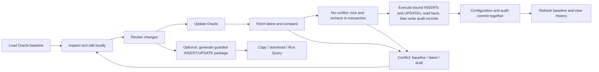

# Monitoring Query — Product requirements

**Status:** revised requirements, ready for review; implementation has not started.
**Date:** 2026-10-13. **Product:** AD Tools. **Route:** `#monitoring-query`. **Category:** Config.
**Decision accepted (revised):** use guarded INSERT/UPDATE for existing edits and new/cloned rows in one reviewed transaction.
Fetch latest Oracle data → show conflicts → apply if unchanged. Disable editing while applying; standardize typed reads and comparisons. Record grouped change history for every successful transaction.
**Initial target:** MONITORING schema on UAT-MONITORING / EVTUAT4_COM. Other environments require explicit profiles and schema validation.

This document owns the feature requirements. [Schema discovery](README.md) owns dated evidence and the complete table/column inventory.
Requirements below describe intended behavior; they do not claim that the current application implements it.

## 1. Problem and outcome

Developers currently assemble monitoring dashboard configuration across related Oracle tables in DBeaver.
A single dashboard menu can contain multiple summary queries, summary fields, detail queries, detail columns and chart settings.
Editing those tables individually makes it difficult to understand the complete menu, clone configurations correctly,
preserve long SQL, and review the exact effect of a change.

Monitoring Query presents the configuration as one navigable hierarchy. Existing edits and new/cloned rows execute directly through AD Tools
as guarded INSERT/UPDATE operations after latest-data conflict checks. Jenkins is optional; the same reviewed plan can produce a standalone INSERT/UPDATE package
for the existing Run Query workflow. Saving a local draft never modifies Oracle; **Update Oracle** explicitly does.
Distinguish draft saved, update committed, outcome unknown, database state verified, script generated and script handed off.

### Success criteria

- A developer can inspect a menu and its query/field relationships without manually joining configuration tables.
- A developer can create, edit or clone a complete menu without manually remapping child IDs.
- Generated SQL modifies only the reviewed configuration rows and rejects stale originals before committing.
- Full SQL/CLOB content survives Oracle import, editing, persistence, generation and verification.
- Existing data defects remain visible; the tool does not silently repair or normalize unrelated configuration.
- A repeatable end-to-end artifact proves direct apply, conflict rejection, rollback and readback independently of script handoff.

## 2. Users and primary jobs

| User job                                   | Required experience                                                                    |
| ------------------------------------------ | -------------------------------------------------------------------------------------- |
| Understand a dashboard                     | Browse channel → menu → summary groups/fields and detail tables/columns/chart          |
| Change a query                             | Edit full SQL and settings; inspect related output mappings; review exact changes      |
| Add monitoring for another provider/status | Clone a block or menu; generate new IDs; remap children; edit SQL explicitly           |
| Change presentation                        | Edit titles, formatting, tone and ordering without modifying query text                |
| Enable or disable a dashboard              | Stage DSH_MENU.IS_ACTIVE, review and generate the change                               |
| Find broken configuration                  | Inspect missing parents, duplicate ordering and incomplete chart/mapping configuration |
| Apply a reviewed update                    | Fetch latest Oracle values, resolve any conflicts, then update directly in AD Tools    |
| Apply new/cloned configuration             | Apply with existing edits through explicit INSERT/UPDATE; optionally export a guarded INSERT/UPDATE package     |
| Check the result                           | Reload affected rows and compare them with the generated expected state                |

## 3. Release scope

### V1

| Entity               | Capability                                                                        |
| -------------------- | --------------------------------------------------------------------------------- |
| DSH_MENU             | Read, create, edit labels/channel/order, activate/deactivate, clone whole menu    |
| DSH_SUMMARY_GROUP    | Read, create, edit query/settings/order, clone with fields                        |
| DSH_SUMMARY_FIELD    | Read, create, edit mapping/presentation/order                                     |
| DSH_DETAIL_TABLE     | Read, create, edit query/settings/order/chart, clone with columns                 |
| DSH_DETAIL_COLUMN    | Read, create, edit mapping/presentation/order                                     |
| DSH_DATASOURCE       | Read a safe projection; select an existing datasource for queries                 |
| DSH_SUMMARY_QUERY    | Read-only compatibility section when present; retain unchanged                    |
| Configuration health | Read-only findings and links to affected entities                                 |
| Change history       | Read-only successful transactions, actor/time, affected rows and complete before/after diffs       |
| Local drafts         | Autosave, restore, discard, refresh/rebase and explicit conflict resolution       |
| Change package       | Diff, guarded apply script, verification SQL, copy/download and Run Query handoff |

Five configuration tables support guarded INSERT/UPDATE for existing edits and new rows. Datasources and the single-summary-query table are read-only in V1.
One reviewed batch can mix existing edits and new parents/children. Apply new parents before their children in the same transaction; no intermediate reload is required.
Review labels each row as Update existing or Create new. Execution must never switch that reviewed intent because the database changed.
Discarding a newly added unsaved block is supported. Removing an existing database row is outside V1.

### Excluded from V1

- Direct DELETE, unrestricted SQL execution, background/autosave DML, automatic Jenkins triggering or automatic dashboard query execution.
  Reviewed INSERT and UPDATE operations through the managed-apply endpoint are included in V1.
- Hard deletion, primary-key renaming, moving existing children to different parents, or automatic orphan cleanup.
- Datasource creation/editing, JDBC URL/credential display, and credential migration from DBeaver.
- USERS, TOKEN, Flyway history, or general-purpose table CRUD.
- Editing/deleting audit history, approval/PR workflows and automatic revert. DSH_CONFIG_AUDIT writes and read-only history are included.
- Editing DSH_SUMMARY_QUERY until its runtime role is confirmed.
- Cross-environment deployment, merge/promotion, or automatic SQL schema/provider substitutions.
- A monitoring dashboard renderer, chart renderer, or claim that database verification proves runtime dashboard behavior.

## 4. Interaction and layout

Use the existing compact developer-tool layout. Support normal and half-width desktop windows, light/dark themes,
keyboard navigation and reachable controls with large SQL/field lists. Mobile optimization is not an acceptance target.

The connection selector and MONITORING schema identity stay visible. The navigation pane groups menus by CHANNEL_NAME;
channel is a string attribute, not a separate database entity. Show label, active status, search, and pending-change count.
Selecting an item opens read-only details. **Edit** enters a local draft; **Add** and **Clone** create draft entities.

A menu exposes **Summary**, **Details**, and **Compatibility** sections. Summary groups own their field lists.
Detail tables own their column lists and **Chart** settings. Use breadcrumbs for the selected context.
Field/column tables show mapping, label, format, tone/alignment and order with inline validation.
SQL uses the existing Oracle Monaco integration with wrap, copy, search and a resizable editor.
Health findings and change review are reachable without losing the selected item or unsaved work.

Primary actions: **Load**, **Edit**, **Add**, **Clone**, **Review Changes**, **Update Oracle**, **Generate SQL**, **Copy SQL**,
**Download Package**, **Open in Run Query**, **Verify Database**, **History**, and **Discard Draft**.
**Update Oracle** fetches latest values and proceeds automatically if no conflict exists; do not add a second confirmation when the
reviewed revision is unchanged. If conflicts exist, stop and show baseline/latest/draft values. Resolution requires another Update Oracle action.
Do not label local persistence as “Save to database” or handoff as “Applied.”



## 5. Loading and schema compatibility

**MQ-01.** Oracle loading is available in Desktop through existing connection/credential services.
No passwords enter route data, local drafts or exports. Web shows a clear Desktop requirement;
V1 does not add a separate browser Oracle proxy or offline package-import product.

**MQ-02.** Select an existing AD Tools connection profile; DBeaver's connection is discovery evidence, not an imported credential profile.
Capture actual service/database identity, current schema and connection profile ID. Require MONITORING and compatible table metadata.
Do not identify an environment using a display name alone. Direct apply use the selected Oracle connection and reassert its identity inside the transaction.
For SQL-script handoff, allow explicitly mapped execution identities when the Jenkins user differs.

**MQ-03.** Validate required tables, PKs, types, length semantics, nullability and relevant constraints against the discovery contract.
Refuse direct apply and generation on incompatible drift and explain the specific mismatch. Fetch CHAR_USED/CHAR_LENGTH/DATA_LENGTH and database character set
where required to validate VARCHAR2 byte versus character limits. Never guess a primary key from the first column.
Unknown constraints or new required columns require a compatibility decision, not optimistic DML.

**MQ-04.** Load complete configuration records and full CLOBs for the selected menu, plus all IDs required for uniqueness and health checks.
Do not accept a maxRows-truncated result as a complete baseline. Use explicit projections, deterministic ordering and bounded/paged reads.
The datasource projection includes ID, display name, active flag, pool size and timeout only; omit JDBC_URL and CREDENTIAL_REF at query time.
Load all summary fields/group IDs for schema-wide orphan detection because orphan fields cannot be reached through an existing menu.

**MQ-05.** Keep remote baseline separate from editable draft. Record load time and scope. Separate query responses are not an atomic snapshot;
refresh/revalidation and execution-time guards provide the concurrency protection. Cancel or ignore late responses from a prior connection/menu.
A failed load must never replace an existing baseline with an empty graph.

## 6. Editing, IDs and cloning

**MQ-06.** Existing primary keys and parent IDs are read-only. New IDs are editable before generation and must be globally unique within their table.
Support descriptive IDs and UUID strings. Suggested IDs use collision-resistant suffixes within VARCHAR2(50), with a fresh database collision check.
Do not impose UUID-only validation or silently truncate IDs.

**MQ-07.** Clone group → fields, detail table → columns/chart, or menu → supported groups/fields/detail tables/columns.
Maintain an explicit old-ID → new-ID map and rewrite only structural references. SQL is copied byte-for-byte unless edited by the developer;
do not replace provider names, date binds or textual occurrences of IDs automatically.
Cloning a menu with a DSH_SUMMARY_QUERY record is blocked in V1 with an explanation, preventing an apparently complete but partial clone.
Orphan fields are excluded from automatic cloning and remain visible as health findings.

**MQ-08.** Reordering stages numeric DISPLAY_ORDER changes for siblings only. Never renumber unrelated parents implicitly.
Existing duplicate values display a warning and use ID as a stable UI tie-breaker; this does not claim the monitoring application uses that tie-breaker.
An explicit reorder can assign consecutive values if they fit the database precision. Untouched duplicates remain untouched.

**MQ-09.** Defaults are visible for new entities and are derived from validated metadata. Existing values are never replaced with defaults on load.
Preserve CREATED\_\* on UPDATE. For new menus set CREATED_BY from the declared actor and use SYSTIMESTAMP for CREATED_AT;
for updated menus set UPDATED_BY and UPDATED_AT. For direct apply use an explicitly configured editor name or the connected Oracle
username resolved by the backend; display its source. A configured editor name is declared attribution, not independently authenticated identity.
Other managed tables have no audit columns; do not invent them. Timestamp fields affected by script execution are verified according to their
expression semantics rather than compared with a precomputed browser timestamp.

**MQ-10.** Persist drafts in a new, feature-owned IndexedDB database `MonitoringQueryDatabase`, version 1,
with `drafts` and `packages` stores. Key drafts by connection profile ID + database identity + schema + menu identity + draft ID.
Store baseline, edits, schema fingerprint, draft revision and timestamps. New menus receive a local draft identity before their database ID is final.
Never reuse or change QuickQueryDatabase/RunQueryDatabase formats.
Autosave failures remain visible and retain work in memory. Reload restores the draft as unverified until its baseline is refreshed.
Switching connection/menu must not attach edits to another target. Discard deletes only the selected local draft.

## 7. Validation and configuration health

Validation runs during editing and again before direct update or generation. Blocking errors identify the entity/field and offer navigation to it.
Warnings remain visible in review and in the package manifest. Scope warnings so unrelated legacy defects do not block a valid edit.

| Rule                                                                                  | Severity / behavior                                                                             |
| ------------------------------------------------------------------------------------- | ----------------------------------------------------------------------------------------------- |
| Required value, correct type/precision, VARCHAR2 length/byte limit                    | Block the affected change                                                                       |
| Duplicate/new ID, missing datasource/menu/group/table parent                          | Block affected change; verify database existence before generation                              |
| IS_ACTIVE or SHOW_CHART outside Y/N                                                   | Block                                                                                           |
| TONE outside ok/fail/pend/info; ALIGN outside left/right; CHART_TYPE outside bar/line | Block; null allowed where DDL allows                                                            |
| PAGE_SIZE outside 1–100                                                               | Block                                                                                           |
| Non-null CHART_TYPE without SQL/label/value fields                                    | Block                                                                                           |
| Existing SHOW_CHART=Y with null CHART_TYPE                                            | Preserve; disclose runtime fallback is unverified                                               |
| Duplicate sibling DISPLAY_ORDER                                                       | Warn; never silently normalize                                                                  |
| Orphan summary field                                                                  | Health error; do not invent a parent or delete it                                               |
| Unknown VALUE_FORMAT                                                                  | Preserve and warn; observed values are suggestions, not an exhaustive enum                      |
| SOURCE_FIELD missing from a confidently parsed query projection                       | Warn pending runtime alias contract; show source/mapping together                               |
| Projection cannot be resolved statically, e.g. SELECT \*                              | Mark mapping unverified; never claim runtime validation                                         |
| New/changed timeout <= 0                                                              | Block as a product rule, explicitly stricter than current DDL; preserve untouched legacy values |
| Missing/extra query binds                                                             | Warn with detected names and context; no automatic bind renaming                                |

SQL analysis must distinguish actual binds from comments, quoted literals and quoted identifiers.
Observed binds: summary/chart `:startDate`, `:endDate`; detail also `:offset`, `:limit`.
Do not require every query to use every observed bind. SQL parsing is advisory, not a proof of read-only execution or correctness.
No edited SQL is executed against its datasource during validation in V1.

## 8. Review and change-package model

**MQ-11.** Review groups changes by menu and entity, showing explicit INSERT or UPDATE operation, PK, modified scalar values, full SQL diff,
parent references and warnings. Unchanged fields generate no UPDATE assignment. Explicit NULL is distinct from unchanged;
empty VARCHAR2 is treated as NULL and rejected for required fields. Required SQL CLOBs cannot be empty.
For optional CLOBs, provide explicit Clear → NULL; preserve a baseline zero-length non-null CLOB as a distinct state.

**MQ-12.** **Update Oracle** freezes the reviewed draft revision, then fetches complete latest rows for every existing row in the batch
and compares all columns with the originally loaded baseline, including full CLOB content and null/empty distinctions.
A changed/deleted original is a conflict even when a different column changed. Show original baseline, latest Oracle value and proposed value;
retain the draft. Offer keep latest or explicitly reapply an edit onto the latest baseline; never provide a silent force-overwrite path.
Unrelated rows outside the change set do not conflict. A fetch/permission/metadata failure blocks writes, not local editing.
If there are no conflicts, proceed directly to the backend transaction described in MQ-15 without another confirmation dialog.
Reject a late preflight response if connection or draft revision changed. Check new-ID absence and referenced parents for the entire mixed batch.
A parent may exist in Oracle or be a reviewed new row earlier in this batch. A new-ID collision blocks the batch; do not update the colliding row.
From Checking Latest until a confirmed result, disable editing, Add, Clone, reorder, Discard Draft, target/menu switching and duplicate submission.
Keep read-only inspection available. Persist the submitted revision and request ID before dispatch; persistence failure blocks dispatch.
If navigation tears down the tool, retain the in-flight request independently of the view. Closing/reloading the app is not rollback;
restore any submitted request without a confirmed result as Outcome Unknown and reconcile before permitting another write.
After a confirmed failure/conflict, unlock editing. After commit, replace the submitted baseline with returned rows and clear its applied edits.
Outcome Unknown keeps the submitted revision frozen until read-only reconciliation completes and the user explicitly resumes.
Script generation performs the same parent/ID preflight; guards are repeated when the script executes.

**MQ-13.** An immutable generated package contains:

- `manifest.json`: format version, package ID, source identity/schema, schema fingerprint, baseline/read times,
  draft revision, declared actor, operations, warnings, expected-state comparison rules and script SHA-256.
- `apply.sql`: standalone guarded INSERT/UPDATE script for the reviewed existing/new rows, with embedded serialized values,
  target identity assertions, baseline/existence checks, rollback-on-error and one commit on success. No unresolved outer bind placeholders.
  Stored dashboard binds remain inside CLOB data. Parameterized backend templates are a separate read-only preview labelled
  **SQL template — requires backend bindings**; they are never the content of Copy SQL or Open in Run Query.
- `verify.sql`: explicit PK-scoped SELECTs with PK first, affected fields and full CLOB readback; no recent-time heuristics.
- `changes.json`: original/desired typed values for changed rows, supporting inspection and verification; contains no credentials.

Direct-apply review also exposes the generated INSERT/UPDATE templates, reviewed create/update intent, changed columns and typed bind values.
The backend regenerates SQL from validated structured operations; it never trusts a client-provided SQL string.
See [UPDATE-EXAMPLES.md](UPDATE-EXAMPLES.md) for representative SELECT/INSERT/UPDATE templates and bind contracts.

The package includes SQL/configuration and must be treated as internal development data.
Do not send it to analytics or a Worker storage service. Copy SQL copies exactly apply.sql; download includes all four files.
Any further edit or target change invalidates the active package and requires a new review/generation.
Old packages remain identifiable by their revision and creation time; they cannot masquerade as the current draft.

## 9. Guarded INSERT/UPDATE and Oracle script contracts

**MQ-14.** Use a feature-specific, metadata-checked allowlist of five managed tables and their exact PKs.
Use explicit `MONITORING.<TABLE>` and explicit column lists. No DDL, GRANT, DELETE, unconstrained writes or unrestricted upsert.
Generate explicit UPDATE statements for reviewed existing rows and explicit INSERT statements for reviewed new rows.
UPDATE uses the verified physical PK in WHERE. INSERT supplies the reviewed new PK and values.
A collision or missing original is a conflict; never switch a reviewed INSERT into UPDATE or UPDATE into INSERT.
Do not generate MERGE/upsert. Review, manifests and execution results identify INSERT versus UPDATE for each operation.
Generate UPDATE assignments only for changed editable columns, plus DSH_MENU.UPDATED_BY/UPDATED_AT where applicable.
Bind every supplied value, including the PK; identifiers come only from the backend allowlist.
Existing PKs/parent IDs/CREATED_* cannot be changed; new rows supply reviewed PK/parent IDs and creation attributes.
Validate required privileges for the generated statements; do not assume previously confirmed UPDATE access proves INSERT access.

**MQ-15.** Direct apply requires a dedicated Tauri → Rust → Oracle sidecar managed-apply operation, separate from read-query endpoints.
One explicit Update Oracle action produces one transaction on one acquired connection with autocommit disabled:

1. Assert target database/service/schema and permissions; revalidate the managed-table contract, audit-table contract, audit INSERT permission and operation intent.
   Reject duplicate table/PK operations, malformed typed values and references to parents absent from both Oracle and the new-row plan.
2. Lock every reviewed existing row using explicit-column SELECT ... FOR UPDATE WAIT 5 in deterministic table/PK order.
   Validate and lock existing referenced parents, including the logical summary-group parent, in the same deterministic lock plan.
   Fetch complete original values while holding locks; never hold a transaction open while the user resolves a conflict.
3. Recompare locked existing rows with the complete submitted baseline. Compare typed scalars, nulls and full CLOB content.
   Missing/changed originals conflict. Check every new PK is absent. Missing new keys cannot be row-locked;
   concurrent creation is handled by the INSERT PK constraint and exact row-count check.
4. On conflict, roll back without applying any row and return current values. Do not silently turn creation into update or update into creation.
5. Execute parameterized INSERTs and UPDATEs according to reviewed intent in parent-before-child order, with deterministic PK ordering within each level.
   Bind SQL_TEXT/CHART_SQL as CLOBs. Require cursor.rowcount=1 for every operation. A concurrent new-ID collision,
   zero-row UPDATE or constraint failure rolls back the whole batch. A no-op draft executes no DML and changes no audit timestamp.
6. Read back all expected affected values on the same transaction connection. Any readback failure/mismatch rolls back the entire batch.
7. Insert and read back one audit record for each changed/new configuration row under MQ-17; any audit failure rolls back all configuration and audit writes.
8. Commit once after configuration and audit rows pass; return confirmed outcome, change ID, audit IDs and typed readback values. Close cursors/release connection in all cases.

The latest fetch provides the conflict experience; locked recheck protects existing rows until commit.
Lock timeout returns a retryable busy state without automatically retrying a write. Permission failure never silently redirects to Jenkins.
Preserve unedited columns and sibling collections. After commit, refresh the baseline and clear only the submitted revision's applied edits.
Postcommit verification reports a later concurrent edit as changed since apply, not as a failed commit.

The versioned request contains reviewed intent, never executable client SQL:

```text
{ version: 1, requestId, connectionProfileId, expectedDatabaseIdentity,
  schema: "MONITORING", schemaFingerprint, draftId, draftRevision,
  operations: [
    { operationId, intent: "update", table, primaryKey,
      baseline: <complete typed original row>, changes: <changed editable columns> },
    { operationId, intent: "insert", table, primaryKey,
      expectedAbsent: true, values: <reviewed typed new-row values> }
  ] }
```

Resolve credentials in the backend. Return structured conflict, validation, permission, lock-timeout and execution errors with operation IDs.
Never expose credentials. Connection loss around commit returns **Outcome Unknown**; preserve draft/request ID and reconcile by readback.
Never blindly retry. Request IDs provide correlation, not durable exactly-once guarantees without a receipt store.
Reconciliation distinguishes desired values, baseline/absence, divergence and unavailable readback; require explicit action before another write.
Matching desired values establishes observed state, not proof this request was the writer.

**Typed value contract (version 1).** Use the same representation for loading, drafts, requests, conflicts, exports and readback:

- SQL NULL: JSON null. An unchanged column is omitted from changes, never represented as null.
- VARCHAR2/CHAR: exact text without trimming, case folding or Unicode normalization; empty VARCHAR2 follows Oracle NULL semantics.
- NUMBER: `{type: "number", value: "<canonical decimal>"}`; use exact decimal arithmetic, no JavaScript Number/float conversion.
  Remove redundant leading/trailing decimal zeros, normalize negative zero, and validate precision/scale against metadata.
- DATE: `{type: "date", value: "YYYY-MM-DDTHH:mm:ss"}` without an invented timezone.
- TIMESTAMP(p): `{type: "timestamp", precision: p, value: "YYYY-MM-DDTHH:mm:ss.<p digits>"}`;
  preserve declared fractional precision without browser Date conversion or session NLS formatting. For p=0 omit the fractional part.
  Unexpected timezone-aware types require a compatibility decision; do not coerce them into this timestamp representation.
- CLOB: `{type: "clob", value: "<complete text>"}`; an empty string inside this wrapper is a non-null empty LOB, distinct from JSON null.
  Preserve whitespace, CR/LF, Unicode and nested bind tokens. Read/conversion errors must fail, never become placeholder strings.

Typed schema metadata determines conversion. The backend parses/validates wrappers and binds actual Oracle types.
Paged reads return an explicit completion marker/continuation token; callers cannot treat a row limit as a complete baseline.
A truncated CLOB or incomplete page set blocks apply/generation. Prove precision, null/empty and completeness round trips before enabling writes.

Generated INSERT/UPDATE packages implement the same reviewed intents and conflict rules inside one guarded PL/SQL transaction unit.
Lock/recompare existing rows, check new IDs, apply parent-first, require one affected row per INSERT or UPDATE, verify configuration and write/verify MQ-17 audit records before a single commit.
Use type-explicit, NLS-independent values and full CLOB comparisons. Roll back/re-raise any error; never use error logging to skip failed rows.
Applied operations invalidate their package for execution; further use requires fresh load/review/generation.
Runner compatibility gates optional script handoff only. Rollback is transaction recovery, not postcommit undo.

**MQ-16.** For direct apply, bind stored query text as CLOB data; inner :startDate/:endDate/:offset/:limit tokens stay
inside that value and are not bound as part of the outer INSERT or UPDATE. Direct writes do not need SQL\*Plus substitution settings or literal chunking.
The remaining serialization requirements apply to standalone generated INSERT/UPDATE scripts. Serialize stored SQL as data. Escape apostrophes correctly and preserve ampersands, semicolons, comments, Unicode,
CR/LF sequences and Oracle bind tokens inside that data. Disable SQL client substitution where the verified runner supports/requires it.
Never interpolate stored SQL as executable statements in the apply script.
Build CLOBs with temporary LOBs and escaped chunks safely below Oracle literal byte limits (target <= 2000 encoded bytes per chunk),
without splitting Unicode characters; release temporary LOBs on success and failure. No entire-CLOB VARCHAR2 or single-literal assumption.
If target encoding/runner transport cannot preserve the content, block generation/handoff with a specific error.

**MQ-17. Change history for every successful transaction.** Both direct apply and exported scripts write DSH_CONFIG_AUDIT
on the same connection and in the same transaction as configuration INSERTs/UPDATEs. Do not use an autonomous transaction.
One audit row per affected configuration row; all rows in one apply share a change ID. No-op batches write no history.
A validation failure, conflict or rollback produces no committed audit rows. Audit permission/serialization/readback failure rolls back the entire batch.
History is a record of committed changes, not PR approvals or editable drafts.

Use the existing table without a schema migration:

- Omit AUDIT_ID (GENERATED ALWAYS AS IDENTITY). Return generated IDs using the Oracle driver/PLSQL output mechanism.
- TABLE_NAME is the allowlisted configuration table; RECORD_ID is its physical PK. ACTION is exactly INSERT or UPDATE.
- OLD_VALUE is SQL NULL for INSERT; for UPDATE it contains the complete locked original row in the JSON envelope below.
- NEW_VALUE contains the complete actual post-DML row, including backend-generated audit attributes, in the same JSON envelope.
  Serialize full typed rows with the MQ-15 contract, including complete SQL/CLOB content, null and empty LOB distinctions.
- CHANGED_BY uses the MQ-09 actor policy. Store the actor source and connected Oracle username in the envelope;
  a declared editor name remains declared attribution, not authenticated identity. Validate VARCHAR2 length before writing.
- Resolve one database SYSTIMESTAMP value per transaction and use it as CHANGED_AT for all its audit rows.
  Group by change ID, never timestamp proximity or consecutive AUDIT_ID values.

Versioned JSON envelope inside OLD_VALUE/NEW_VALUE CLOBs:

```text
{ source: "ad-tools.monitoring-query", version: 1,
  changeId: <UUID identifying this execution attempt>, requestId, operationId,
  menuId: <owning menu ID>, operationCount: <number of changed/new rows>,
  actorSource, databaseUsername, row: <complete typed configuration row> }
```

Allocate and persist the change ID before dispatch, alongside the immutable submitted request.
A standalone script allocates a fresh change ID at execution and returns/displays it with its audit IDs; package ID is separate provenance.
All audit entries share that execution's change ID. Validate existing application audit consumers before enabling this new envelope;
this is the AD Tools writing contract, not evidence that other applications already use it. Avoid duplicate automatic auditing if triggers appear.
Existing/foreign audit formats are preserved; never rewrite them or infer grouping they do not contain.

**History UI.** Open History for the selected menu, newest transactions first, with database time, actor, change ID and INSERT/UPDATE counts.
Expand a transaction to list affected tables/PKs and inspect complete before/after scalar and SQL diffs.
Use the stored menu ID so child changes remain discoverable even if the current hierarchy later changes.
Read only safe explicit audit projections in bounded pages; query/group the envelope by change ID and source/version.
Load large OLD_VALUE/NEW_VALUE CLOBs when opening a diff. Legacy/unrecognized entries show as individual entries with format/grouping unverified.
Missing history access, malformed JSON or incomplete reads show explicit states; do not silently claim no history or a complete transaction.
History is read-only. No automatic undo; reapplying old values would require a new reviewed and conflict-checked transaction.

After a confirmed commit, link to the new history entry. For Outcome Unknown, a complete matching audit group plus expected configuration
provides additional committed-change evidence; verify target, request/change ID, operation count and contents before resolving state.
Missing/incomplete audit readback does not prove rollback and never authorizes automatic retry. Keep the existing reconciliation rules.
These audit rows are application change history, not tamper-proof security audit or exactly-once execution receipts.

## 10. Optional SQL handoff and verification

**MQ-18.** Direct apply has no Jenkins dependency. For optional execution of the reviewed mixed batch, reuse `run-query` navigation and SQL injection; Open in Run Query populates the editor and never triggers a job.
Extend the route contract with versioned optional metadata:

```text
{ sql, monitoringPackage: { version: 1, packageId, scriptSha256,
    sourceIdentity, schema, draftRevision, requiresAtomicExecution: true } }
```

Run Query validates the selected Jenkins job/environment against an explicitly configured target-identity mapping.
Do not infer a mapping from similar display names. Mismatch or absent mapping blocks managed execution until resolved.
Preserve the package hash and provenance. Manual SQL edits invalidate managed-package status and require regeneration in Monitoring Query.

**MQ-19.** Do not pass this transaction through generic SQL chunk splitting. Run Query currently offers splitting above a 90 KB threshold;
managed packages must disable that path, calculate UTF-8 transport size using the actual runner limit, and explain oversize failures.
The developer can reduce the reviewed change set into separately reviewed packages, each with its own atomicity boundary.
Do not claim atomicity across packages. Copy/download remain available but oversized packages are not marked ready for this runner.

**MQ-20.** Before enabling managed Run Query execution, prove anonymous PL/SQL handling, delimiters, substitution behavior,
CLOB transport, single-session execution, commit/rollback, stop-on-error and propagated failure status against the actual Jenkins runner.
The current semicolon validator and size-split behavior are integration risks, not proof of PL/SQL compatibility.
Compatibility work belongs to this feature's implementation scope. Do not silently downgrade to unguarded DML if the runner fails this gate.

**MQ-21.** Direct-apply states: **Draft**, **Checking Latest**, **Conflict**, **Updating**, **Committed**,
**Outcome Unknown**, **Verified**, **Verification Mismatch** and **Failed**. Never show Committed without a confirmed commit response.
Precommit readback failure rolls back; postcommit refresh failure retains Committed with verification pending.
SQL-package lifecycle states: **Draft**, **Needs Refresh**, **Conflict**, **Ready for Review**, **Generated**, **Handed Off**,
**Verified**, **Verification Mismatch**. Run Query owns actual job status; no automatic completion callback is assumed.
Handed Off records editor transfer only. Verify Database is an explicit read-only operation against the package's source target.
Compare all intended changed/new rows with package expectations using typed values and complete CLOBs.
A Jenkins success message is not sufficient for Verified. Read failure or mismatch preserves the draft and package for investigation.
Verification of database values does not assert dashboard cache refresh, rendering or query execution.

## 11. Technical composition

Current checkout is a Vanilla JS SPA with class-based BaseTool, shared Oracle/Monaco services and Tauri Oracle connectivity.
Extend the Oracle bridge with a dedicated managed-apply transaction command; Jenkins remains optional for INSERT/UPDATE scripts.
Implement in that active architecture; do not make this feature contingent on a React cutover or add a second shell.
If the implementation checkout has since migrated, follow its active architecture contract and preserve the same service/data behavior.

| Boundary                                   | Responsibility                                                                                           |
| ------------------------------------------ | -------------------------------------------------------------------------------------------------------- |
| Tool controller / template / scoped styles | Navigation, forms, review, state rendering and widget lifecycle                                          |
| Oracle repository                          | Explicit metadata/configuration reads, complete fetches, identity, refresh and managed-apply invocation |
| Managed-apply backend                     | Allowlist, typed binds, full-row locked conflict check, one transaction, atomic audit writes, rollback and committed readback |
| Domain graph                               | Typed values, original/draft separation, ID maps, dependency traversal and clone rules                   |
| Validation / health service                | DDL-backed rules, advisory SQL analysis and scoped findings                                              |
| Change planner                             | Baseline comparison, explicit INSERT/UPDATE plan and conflicts                                      |
| Oracle serializer / package service        | Guarded script, CLOB encoding, verification SQL, manifest/hash and exports                               |
| Draft store                                | Feature-owned IndexedDB persistence and revision management                                              |
| Run Query adapter                          | Versioned handoff, target mapping, atomic-package policy and provenance                                  |

Register `monitoring-query` in tools.json/toolDefinitions.js and use standard Desktop capability handling.
Reuse OracleConnectionService and keychain-backed credentials. Add a separate managed-apply method and matching Rust/sidecar endpoint;
keep existing query endpoints separate from DML. Enforce the existing bridge authentication/access boundary for the new endpoint too.
Use existing Monaco and shared components. Dispose editor models, listeners and pending work on lifecycle teardown;
restore persisted edits after navigation. Route cancellation must not lose a draft or inject stale data into a new connection.
Do not log SQL/CLOB content or connection URLs. Analytics, if used, contain action IDs, counts, sizes and result categories only.

## 12. Acceptance and verification

Prefer end-to-end verification; use focused isolation tests only for failures that cannot be exercised efficiently through the complete flow.
When isolation tests are necessary, document failure modes and write tests before implementation, per AGENTS.md.
Do not install missing tooling automatically. No live UAT mutation is needed to demonstrate the feature.

| ID    | Scenario and pass condition                                                                                                                |
| ----- | ------------------------------------------------------------------------------------------------------------------------------------------ |
| AC-01 | Read-only load against the named UAT connection reconstructs menu hierarchy and complete SQL; retains no datasource secrets                |
| AC-02 | Discovery fixture reproduces 19 orphan summary fields and duplicate ordering; no automatic correction occurs                               |
| AC-03 | Edit a title only: review and DML change that field plus defined menu UPDATED\_\* only; unrelated SQL is preserved                         |
| AC-04 | Create/clone group, detail table and menu: IDs are unique, children point to cloned parents, SQL is unchanged until explicitly edited      |
| AC-05 | Clone a menu containing compatibility summary query: action is blocked with the V1 limitation                                              |
| AC-06 | Required/null/chart/precision validation matches DDL; unknown formats and Y-with-null-chart states round-trip without coercion             |
| AC-07 | Draft survives navigation/reload; two connections with identical menu IDs remain independent; persistence failure is visible               |
| AC-08 | Remote edit before latest fetch shows a conflict; edit after latest fetch fails the locked recheck and rolls back all updates              |
| AC-09 | Apostrophes, ampersands, Unicode, embedded binds, >4000-character SQL and optional empty/null CLOBs survive a full LOCAL Oracle round trip |
| AC-10 | Forced failure midway through direct LOCAL INSERTs/UPDATEs leaves all rows unchanged; AD Tools receives structured failure                         |
| AC-11 | Stale update retry fails baseline checks; zero-row UPDATE/lock timeout cannot succeed; new-ID collision fails direct/script guards                |
| AC-12 | Run Query receives exact script/hash, requires a matching target, never auto-runs, and rejects managed-script edits/splitting              |
| AC-13 | Package near/above actual runner size limit gets correct byte-based behavior; no partial/chunked execution occurs                          |
| AC-14 | Confirmed commit, outcome unknown and verified state stay distinct; mismatches preserve recoverable draft/package                          |
| AC-15 | Normal and half-width Desktop, light/dark, keyboard use, empty state, long names and large SQL lists keep controls reachable               |
| AC-16 | Wrong schema, drift, missing credentials, interrupted/partial fetch and stale response produce explicit recoverable states                 |
| AC-17 | One mixed INSERT/UPDATE batch edits an existing row and creates a parent/children; all commit together or all roll back                          |
| AC-18 | Deleted existing row is not recreated; colliding new ID is not overwritten, including a collision after preflight                       |
| AC-19 | Editing/target changes/duplicate submission are disabled in flight; reload restores unresolved requests for reconciliation              |
| AC-20 | Exact NUMBER and TIMESTAMP(6) values, null/empty CLOB and paged completeness survive every read/draft/apply boundary                      |
| AC-21 | Copy SQL and Run Query receive standalone guarded INSERT/UPDATE SQL with embedded values; backend templates are clearly labelled separately    |
| AC-22 | A mixed successful batch produces one correctly grouped history entry with complete typed before/after values per affected row         |
| AC-23 | Forced audit INSERT/readback failure rolls back all configuration/audit writes; conflict/no-op writes no audit history                  |
| AC-24 | Direct apply and exported script both audit atomically; each script execution has its own change ID                                      |
| AC-25 | History supports menu scope, paging, full SQL diffs and foreign/malformed formats; incomplete/denied reads are explicit                   |

For each E2E run retain a dated artifact containing commit, commands, environment, fixture/setup, screenshots or trace,
package hash, expected/actual database comparisons, result, cleanup and reproduction steps. Keep credentials out of artifacts. Add E2E cases for denied INSERT/UPDATE permission, double submission, connection changes during preflight,
commit acknowledgment loss, readback reconciliation and stored SQL containing nested bind tokens.
Label source checks, fixtures, browser behavior, LOCAL Oracle execution, Jenkins execution and packaged Desktop evidence separately.
Generated SQL success on LOCAL Oracle is not proof of Jenkins or UAT behavior.

## 13. Delivery gates and unresolved application contracts

1. Validate schema/identity loading, standardized typed reads and the dedicated Oracle managed-apply API contract.
2. Implement hierarchy, drafts, editing/cloning, health and review.
3. Implement mixed-batch guarded INSERT/UPDATE and prove intent checks, dependency order, locked recheck, typed/CLOB binding, rollback and uncertain-commit recovery in LOCAL Oracle.
4. Implement standalone INSERT/UPDATE generation and optional Run Query target mapping/atomic transport; verify the runner before enabling handoff.
   Direct INSERT/UPDATE delivery does not depend on Jenkins availability or this integration gate.
5. Prove atomic audit writes, transaction grouping, history diffs and legacy-format handling in LOCAL Oracle.
6. Complete Desktop acceptance, read-only UAT load/readback checks and reproducible evidence.

Monitoring application cache/refresh behavior, exact value-format vocabulary, alias casing, pagination contract,
chart fallback and DSH_SUMMARY_QUERY usage remain unverified. V1 can inspect/edit confirmed configuration while preserving unknown values;
it must not claim runtime preview or compatibility-table editing. These unknowns do not justify inventing defaults or automatic reload actions.
DELETE and future approval/revert workflows require separately agreed contracts. DSH_CONFIG_AUDIT history is included under MQ-17.
INSERT-based creation and editing are in scope; validate actual runtime privileges rather than assuming UPDATE access includes creation.
