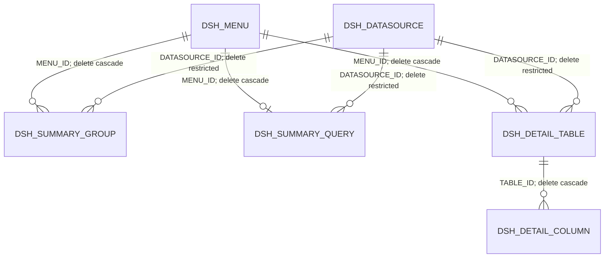

# MONITORING schema discovery

Observed on 2026-10-12, approximately 13:21–13:25 WIB, through DBeaver 26.2.2.
Folder: **UAT-MONITORING**. Connection/service: **EVTUAT4_COM**. Session user and current schema: **MONITORING**.

This is a verified schema/configuration assessment and historical feature exploration.
[PRD.md](PRD.md) owns the current feature scope and accepted execution workflow; this discovery is not a completed feature.
Only SELECTs and metadata reads were executed. No database rows, constraints, grants, or credentials were changed.

## Evidence and reproduction

- `schema-ddl-2026-10-12.json`: DBeaver JSON export of all 11 `DBMS_METADATA.GET_DDL('TABLE', ...)` results.
- `config-snapshot-2026-10-12.json`: seven configuration tables plus trigger/object/session metadata.
  Datasource JDBC URLs and credential references are excluded; USERS, TOKEN and audit values were not exported.
- `inspect.sql`: reproducible discovery SELECTs and optional focused rechecks.
- Run `python3 docs/monitoring/analyze_snapshot.py` from the repository root to reproduce snapshot integrity findings.

In DBeaver, execute the DDL query and configuration UNION query separately, then Export data → JSON → Use fetched rows →
UTF-8 → inline CLOB values. Save new dated files rather than replacing this evidence.
The DDL and configuration exports were captured at different times; this is not one atomic schema/data snapshot.

## Tables and ownership

| Table                 | Primary key                 | Observed rows | Purpose / proposed treatment                                            |
| --------------------- | --------------------------- | ------------: | ----------------------------------------------------------------------- |
| DSH_MENU              | MENU_ID, varchar2(50)       |            16 | Channel/menu definition, labels, ordering, activation, audit attributes |
| DSH_DATASOURCE        | DATASOURCE_ID, varchar2(30) |             4 | Query connection definitions; privileged administration                 |
| DSH_SUMMARY_QUERY     | MENU_ID, varchar2(50)       |             0 | Single summary query per menu; runtime role needs confirmation          |
| DSH_SUMMARY_GROUP     | GROUP_ID, varchar2(50)      |            39 | Multiple summary query blocks per menu                                  |
| DSH_SUMMARY_FIELD     | FIELD_ID, varchar2(50)      |           194 | Summary output aliases, titles, formatting, tone and order              |
| DSH_DETAIL_TABLE      | TABLE_ID, varchar2(50)      |            29 | Detail query, pagination, optional chart and order                      |
| DSH_DETAIL_COLUMN     | COLUMN_ID, varchar2(50)     |           194 | Detail output aliases, titles, formatting, alignment and order          |
| DSH_CONFIG_AUDIT      | AUDIT_ID, identity NUMBER   |   Not queried | Change history; proposed read-only UI, automatic write with changes     |
| USERS                 | USERNAME, varchar2(50)      |   Not queried | Application authentication/roles; separate administration scope         |
| TOKEN                 | TOKEN_ID, varchar2(36)      |   Not queried | Application session lifecycle; separate administration scope            |
| flyway_schema_history | installed_rank, NUMBER      |   Not queried | Migration bookkeeping; exclude from ordinary data management            |

All keys are single-column. Configuration string IDs are globally unique within their table, not merely within a parent menu.
No key defaults generate configuration IDs. Existing IDs mix descriptive strings and UUID-like strings; do not require UUIDs.
`flyway_schema_history` and its columns use quoted lowercase identifiers.

## Relationships

**Logical relationship only:** DSH_SUMMARY_GROUP → DSH_SUMMARY_FIELD through GROUP_ID has no database FK.
TOKEN.USERNAME → USERS.USERNAME and TOKEN.REPLACED_BY_TOKEN_ID → TOKEN.TOKEN_ID also have no FKs.
Audit TABLE_NAME/RECORD_ID identify records logically; there is no FK.

Create parents before children: datasource/menu → summary groups/detail tables/summary query → fields/columns.
Deleting a menu cascades through groups, its single summary query, detail tables and detail columns.
Summary fields are not cascaded: explicit field cleanup or an approved schema migration is needed.
Deleting a referenced datasource is blocked by its FKs. Treat IDs as immutable during ordinary editing;
renaming a key requires a deliberate migration of references, including logical references.

## Actual data findings

- 16 menus: 14 active, 2 inactive. Channels: NBDS, Livin by Mandiri, NBDS_TEST_DATASOURCE.
- Four active datasource IDs: NBDS, LIVIN_CORE, NBDS_TEST_DATASOURCE, LIVIN_COMP.
- **19 orphan summary fields**: 4 reference `livin-bullion-buy-overall-hit-success`; 15 reference `nbds-transaksi-ringkasan-valas`.
  This was calculated from the complete exported field/group rows. No cleanup was performed.
- No orphan detail columns in the snapshot.
- Duplicate summary-group order: `livin-bullion-buy-pegadaian`, order 2, two groups.
- Duplicate detail-table order: buy menus for hartadinata, mandiri, pegadaian and antam each have three tables at order 1.
- Duplicate summary-field order: sell-failed-antam, sell-timeout-pegadaian, buy-failed-antam and buy-timeout-pegadaian
  groups each have two fields at order 3. There is no DDL uniqueness constraint for these orders.
- All 29 detail tables use PAGE_SIZE=10 and SHOW_CHART=Y, but only one has CHART_TYPE=bar; 28 have null chart type.
  A UI must preserve this valid existing state rather than silently creating chart settings.
- Existing query timeouts are 5000 or 50000 ms. Do not hardcode a five-second maximum.
- Summary formats observed: text, number, currency. Detail formats also include date and datetime.
  These are observed values, not a confirmed exhaustive runtime enum; VALUE_FORMAT is not CHECK-constrained.
- All detail-column ALIGN values are null; summary-field TONE is usually null. Preserve nullable choices.
- DSH_SUMMARY_QUERY is empty. Do not assume it is deprecated or interchangeable with summary groups without application evidence.

## Field and SQL contracts

The full column contract is transcribed below; exact DDL, including checks/FKs/storage, remains in the raw export.
Additional validation rules:

- IS_ACTIVE / SHOW_CHART: Y or N. Datasource pool: 1–20. Detail page size: 1–100.
- TONE: ok, fail, pend, info or null. ALIGN: left, right or null. CHART_TYPE: bar, line or null.
- Non-null CHART_TYPE requires non-null CHART_SQL, CHART_LABEL_FIELD and CHART_VALUE_FIELD.
  SHOW_CHART itself does not impose that requirement in the DDL.
- Display order NUMBER(3,0), pool NUMBER(3,0), timeout NUMBER(6,0): respect numeric precision.
  Positive display order and timeout may be useful product rules but are not currently CHECK constraints.
- Summary GROUP_TITLE is nullable; detail TABLE_TITLE and field/column titles are required.
- SQL_TEXT and CHART_SQL are CLOBs. Read/write full values; preserve SQL hints, whitespace, apostrophes, newlines and bind names.
  Distinguish unchanged, SQL NULL, and empty input explicitly; Oracle empty VARCHAR2 becomes NULL.
- Defaults apply when omitted on INSERT, not when explicitly setting NULL; preserve CREATED\_\* on UPDATE.
  Menu UPDATED_AT/BY have no automatic trigger/default update behavior.
- AUDIT_ID is GENERATED ALWAYS: omit it when inserting audit entries. CHANGED_AT defaults to SYSTIMESTAMP.

Stored summary SQL uses `:startDate` and `:endDate`. Detail SQL additionally uses `:offset` and `:limit`.
Chart SQL observed uses the date binds. Maximum observed SQL length: 2231 characters for summary groups,
3476 for detail SQL, 259 for chart SQL; these are sample maxima, not field limits.
SOURCE_FIELD and chart label/value fields must match query output aliases, accounting for quoted versus unquoted Oracle casing.
Actual execution/output alias matching was not verified. Stored SQL was read, never executed.

Datasource configuration selects where a dashboard query runs; it is distinct from the MONITORING connection used to edit configuration.
A JDBC_URL observed during inspection embedded credentials. Treat the entire URL as sensitive: redact in lists, logs, diffs and exports,
and avoid exposing it through general table browsing. The retained configuration export omits URLs and credential references.
Do not assume CREDENTIAL_REF alone guarantees that secrets are absent from JDBC_URL.

## Audit and application behavior

The metadata query found no MONITORING triggers and no other objects after excluding tables, indexes, LOBs and sequences.
Consequently, there is no observed trigger-based configuration audit, automatic UPDATED\_\* maintenance, or stored configuration API.
The audit table's existence does not prove the monitoring application writes it. Application-side behavior is unverified.
Database audit integration requires an agreed action vocabulary, actor and OLD_VALUE/NEW_VALUE serialization.
The current PRD includes application-written audit rows in the same transaction as configuration changes; the table does not populate automatically.
If audit integration is added, commit configuration and audit records together. Audit history should not be an ordinary editable table.

USERS accepts roles USER/ADMIN, activity Y/N and hashes starting `$2`; TOKEN requires a 64-character TOKEN_HASH.
These checks do not define a complete authentication protocol. Do not implement user/token CRUD based only on these columns.

## AD Tools integration assessment

Current source was inspected; these are source findings, not a live AD Tools-to-UAT integration test.

- `frontend/core/OracleConnectionService.js` provides shared pool lifecycle, keychain-backed Tauri credential commands and query wrappers.
  Reuse this connection boundary rather than copying DBeaver credentials or adding a separate credential store.
- `tauri/src/oracle_sidecar.rs` and `tauri/sidecar/oracle_sidecar.py` expose SQL/maxRows query requests without bind parameters.
  `_execute_query_sync` executes SQL then fetches result rows. It does not provide an explicit write transaction/commit API.
  Do not route saves through it and assume persistence, affected-row validation, atomicity or audit.
- Quick Query generates INSERT/UPDATE/MERGE and verification SQL; its run action hands SQL to Run Query.
  Its primary-key helper falls back to the first field when PK metadata is missing. A managed editor must use verified keys and fail closed.
- No MONITORING/DSH-specific feature references were found in frontend, tauri/src or existing docs before this assessment.
- Existing Monaco/Oracle editor, connection services and tool lifecycle are reusable foundations.
  Current implementation must follow repository architecture and the active React migration decisions at build time.

## Proposed feature workflow

A menu-oriented editor fits this schema better than eleven unrelated editable grids:

1. Choose environment/connection and verify MONITORING schema; browse channel → menu.
2. Inspect the menu, summary groups → fields, and detail tables → columns/chart.
3. Explicitly edit, add or clone a block/menu. Clone with new globally unique IDs and remap every child reference.
4. Edit full SQL in Monaco alongside datasource, bind inputs and output-field mappings.
5. Validate required fields, constraints, parent existence, duplicate IDs, output mappings and chart dependencies.
   Surface current orphan/order problems without silently rewriting existing data.
6. Review a before/after diff, dependency effects and generated change plan.
7. Apply through the selected execution route and read back affected rows before reporting success.
8. Offer audit/history inspection and deliberate menu activation/deactivation. If deletion is included, preview all affected records,
   explicitly include logical summary fields, and respect datasource restrictions.

The current [PRD.md](PRD.md) defines a dedicated managed-apply endpoint for explicit INSERT/UPDATE across five configuration tables,
with complete locked-row conflict checks, typed/CLOB binding, one transaction, readback and atomic DSH_CONFIG_AUDIT history writes.
A mixed batch can create parents/children and edit existing rows together. Optional guarded script export uses the same rules.
History groups affected-row entries using a shared change ID in versioned OLD_VALUE/NEW_VALUE JSON; the existing table has no transaction-ID column.
This is the agreed AD Tools plan, not verified existing monitoring-application behavior. No edited dashboard query executes during save/validation.
The PRD supersedes the historical alternatives above. Existing audit-consumer compatibility still needs verification before enabling writes.

## Remaining questions before implementation

- Does the monitoring application cache configuration, and what refresh/reload is required after changes?
- Which schema tables does it currently read, especially DSH_SUMMARY_QUERY versus DSH_SUMMARY_GROUP?
- What are the exact runtime value-format, query-bind, pagination, alias-casing and chart fallback contracts?
- Do existing audit consumers accept the AD Tools versioned JSON envelope and INSERT/UPDATE action vocabulary defined in PRD MQ-17?
- Should the first release include datasource administration, deletion and whole-menu cloning, or start with menu/query/field editing?
- What AD Tools credential/profile should map to this UAT connection? DBeaver access does not establish an AD Tools profile or write pathway.

No runtime monitoring application source/API, dashboard rendering, cache behavior, target query execution, write grants under a future AD Tools
identity, or write/rollback behavior was verified. No application code was changed and no feature tests/builds were run for this discovery.

## Column contract from live DDL

Notation: NN = NOT NULL. Omitted default means none declared.

### DSH_CONFIG_AUDIT

| Column     | Type          | Required | Default                      |
| ---------- | ------------- | -------- | ---------------------------- |
| AUDIT_ID   | NUMBER        | NN       | GENERATED ALWAYS AS IDENTITY |
| TABLE_NAME | VARCHAR2(30)  | NN       | —                            |
| RECORD_ID  | VARCHAR2(50)  | NN       | —                            |
| ACTION     | VARCHAR2(10)  | NN       | —                            |
| OLD_VALUE  | CLOB          | Nullable | —                            |
| NEW_VALUE  | CLOB          | Nullable | —                            |
| CHANGED_BY | VARCHAR2(50)  | Nullable | —                            |
| CHANGED_AT | TIMESTAMP (6) | NN       | SYSTIMESTAMP                 |

### DSH_DATASOURCE

| Column             | Type          | Required | Default      |
| ------------------ | ------------- | -------- | ------------ |
| DATASOURCE_ID      | VARCHAR2(30)  | NN       | —            |
| DISPLAY_NAME       | VARCHAR2(100) | NN       | —            |
| JDBC_URL           | VARCHAR2(500) | NN       | —            |
| CREDENTIAL_REF     | VARCHAR2(50)  | NN       | —            |
| POOL_MAX           | NUMBER(3,0)   | NN       | 5            |
| CONNECT_TIMEOUT_MS | NUMBER(6,0)   | NN       | 5000         |
| DESCRIPTION        | VARCHAR2(300) | Nullable | —            |
| IS_ACTIVE          | CHAR(1)       | NN       | 'Y'          |
| CREATED_BY         | VARCHAR2(50)  | Nullable | —            |
| CREATED_AT         | TIMESTAMP (6) | NN       | SYSTIMESTAMP |

### DSH_DETAIL_COLUMN

| Column        | Type          | Required | Default |
| ------------- | ------------- | -------- | ------- |
| COLUMN_ID     | VARCHAR2(50)  | NN       | —       |
| TABLE_ID      | VARCHAR2(50)  | NN       | —       |
| COLUMN_TITLE  | VARCHAR2(100) | NN       | —       |
| SOURCE_FIELD  | VARCHAR2(50)  | NN       | —       |
| VALUE_FORMAT  | VARCHAR2(20)  | NN       | 'text'  |
| ALIGN         | VARCHAR2(6)   | Nullable | —       |
| DISPLAY_ORDER | NUMBER(3,0)   | NN       | 1       |

### DSH_DETAIL_TABLE

| Column             | Type          | Required | Default  |
| ------------------ | ------------- | -------- | -------- |
| TABLE_ID           | VARCHAR2(50)  | NN       | —        |
| MENU_ID            | VARCHAR2(50)  | NN       | —        |
| DATASOURCE_ID      | VARCHAR2(30)  | NN       | —        |
| TABLE_TITLE        | VARCHAR2(150) | NN       | —        |
| TONE               | VARCHAR2(10)  | Nullable | —        |
| PAGE_SIZE          | NUMBER(3,0)   | NN       | 10       |
| SQL_TEXT           | CLOB          | NN       | —        |
| TIMEOUT_MS         | NUMBER(6,0)   | NN       | 5000     |
| DISPLAY_ORDER      | NUMBER(3,0)   | NN       | 1        |
| SHOW_CHART         | CHAR(1)       | NN       | 'Y'      |
| CHART_TYPE         | VARCHAR2(10)  | Nullable | —        |
| CHART_TITLE        | VARCHAR2(150) | Nullable | —        |
| CHART_SQL          | CLOB          | Nullable | —        |
| CHART_LABEL_FIELD  | VARCHAR2(50)  | Nullable | —        |
| CHART_VALUE_FIELD  | VARCHAR2(50)  | Nullable | —        |
| CHART_VALUE_FORMAT | VARCHAR2(20)  | Nullable | 'number' |

### DSH_MENU

| Column        | Type          | Required | Default      |
| ------------- | ------------- | -------- | ------------ |
| MENU_ID       | VARCHAR2(50)  | NN       | —            |
| CHANNEL_NAME  | VARCHAR2(100) | NN       | —            |
| MENU_LABEL    | VARCHAR2(100) | NN       | —            |
| DISPLAY_ORDER | NUMBER(3,0)   | NN       | 1            |
| IS_ACTIVE     | CHAR(1)       | NN       | 'Y'          |
| CREATED_BY    | VARCHAR2(50)  | Nullable | —            |
| CREATED_AT    | TIMESTAMP (6) | NN       | SYSTIMESTAMP |
| UPDATED_BY    | VARCHAR2(50)  | Nullable | —            |
| UPDATED_AT    | TIMESTAMP (6) | Nullable | —            |

### DSH_SUMMARY_FIELD

| Column        | Type          | Required | Default |
| ------------- | ------------- | -------- | ------- |
| FIELD_ID      | VARCHAR2(50)  | NN       | —       |
| GROUP_ID      | VARCHAR2(50)  | NN       | —       |
| FIELD_TITLE   | VARCHAR2(100) | NN       | —       |
| SOURCE_FIELD  | VARCHAR2(50)  | NN       | —       |
| VALUE_FORMAT  | VARCHAR2(20)  | NN       | 'text'  |
| TONE          | VARCHAR2(10)  | Nullable | —       |
| DISPLAY_ORDER | NUMBER(3,0)   | NN       | 1       |

### DSH_SUMMARY_GROUP

| Column        | Type          | Required | Default |
| ------------- | ------------- | -------- | ------- |
| GROUP_ID      | VARCHAR2(50)  | NN       | —       |
| MENU_ID       | VARCHAR2(50)  | NN       | —       |
| DATASOURCE_ID | VARCHAR2(30)  | NN       | —       |
| GROUP_TITLE   | VARCHAR2(100) | Nullable | —       |
| SQL_TEXT      | CLOB          | NN       | —       |
| TIMEOUT_MS    | NUMBER(6,0)   | NN       | 5000    |
| DISPLAY_ORDER | NUMBER(3,0)   | NN       | 1       |

### DSH_SUMMARY_QUERY

| Column        | Type         | Required | Default |
| ------------- | ------------ | -------- | ------- |
| MENU_ID       | VARCHAR2(50) | NN       | —       |
| DATASOURCE_ID | VARCHAR2(30) | NN       | —       |
| SQL_TEXT      | CLOB         | NN       | —       |
| TIMEOUT_MS    | NUMBER(6,0)  | NN       | 5000    |

### TOKEN

| Column               | Type          | Required | Default      |
| -------------------- | ------------- | -------- | ------------ |
| TOKEN_ID             | VARCHAR2(36)  | NN       | —            |
| USERNAME             | VARCHAR2(50)  | NN       | —            |
| TOKEN_HASH           | VARCHAR2(64)  | NN       | —            |
| ISSUED_AT            | TIMESTAMP (6) | NN       | SYSTIMESTAMP |
| EXPIRES_AT           | TIMESTAMP (6) | NN       | —            |
| REVOKED_AT           | TIMESTAMP (6) | Nullable | —            |
| REPLACED_BY_TOKEN_ID | VARCHAR2(36)  | Nullable | —            |
| CREATED_BY_IP        | VARCHAR2(50)  | Nullable | —            |

### USERS

| Column        | Type          | Required | Default      |
| ------------- | ------------- | -------- | ------------ |
| USERNAME      | VARCHAR2(50)  | NN       | —            |
| PASSWORD_HASH | VARCHAR2(100) | NN       | —            |
| ROLE          | VARCHAR2(20)  | NN       | 'USER'       |
| IS_ACTIVE     | CHAR(1)       | NN       | 'Y'          |
| LAST_LOGIN_AT | TIMESTAMP (6) | Nullable | —            |
| LAST_LOGIN_IP | VARCHAR2(50)  | Nullable | —            |
| CREATED_BY    | VARCHAR2(50)  | Nullable | —            |
| CREATED_AT    | TIMESTAMP (6) | NN       | SYSTIMESTAMP |
| UPDATED_AT    | TIMESTAMP (6) | Nullable | —            |

### flyway_schema_history

| Column         | Type           | Required | Default           |
| -------------- | -------------- | -------- | ----------------- |
| installed_rank | NUMBER(\*,0)   | NN       | —                 |
| version        | VARCHAR2(50)   | Nullable | —                 |
| description    | VARCHAR2(200)  | NN       | —                 |
| type           | VARCHAR2(20)   | NN       | —                 |
| script         | VARCHAR2(1000) | NN       | —                 |
| checksum       | NUMBER(\*,0)   | Nullable | —                 |
| installed_by   | VARCHAR2(100)  | NN       | —                 |
| installed_on   | TIMESTAMP (6)  | NN       | CURRENT_TIMESTAMP |
| execution_time | NUMBER(\*,0)   | NN       | —                 |
| success        | NUMBER(1,0)    | NN       | —                 |
