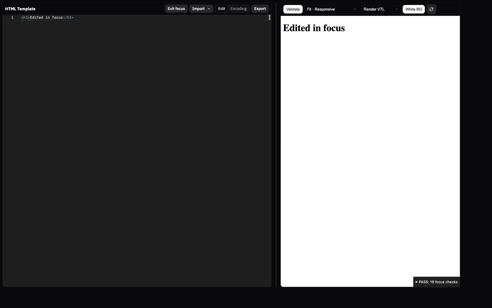

# HTML Template focus mode verification

Verified 2026-10-28 in the local Vite browser at desktop (1440 × 900) and narrow (592 × 755) sizes.

## Reproduce

1. Run `npm run dev`.
2. Open `http://localhost:1234/tools/html-editor/tests/focus-check.html`.
3. Wait for **PASS: 19 focus checks** at desktop width, or **PASS: 18 focus checks** below 901px.
4. Expand the results disclosure to inspect individual assertions. The fixture uses in-memory documents and leaves focus mode active.
5. Press Escape in the code editor: the normal shell, tabs, context panel, and previous split return.
6. Re-enter using **Focus mode**, drag the divider, then use **Exit focus**. The normal split is restored.

The browser checks exercise shell visibility, both panes, vertical space, collapsed-source recovery,
cursor and scroll preservation, menu-first Escape handling, keyboard focus restoration, original panel
and split restoration, deactivation cleanup, live preview updates, and edit preservation.
On narrow screens the two panes stack vertically. Desktop keeps the draggable horizontal split.
Native window controls are retained through the existing titlebar; the installed Tauri app was not rebuilt.

Additional verification: existing service, document store, and preview bridge tests passed (16 tests total).
ESLint reported zero errors and 18 existing warnings; the Impeccable detector returned no findings.

Width regression: the fixture now includes the inline margin written by `Sidebar.updateSidebarState`.
The new width assertion failed before the scoped CSS override. Focus now places the workspace 8px
from each viewport edge and restores the original sidebar margin on exit.
