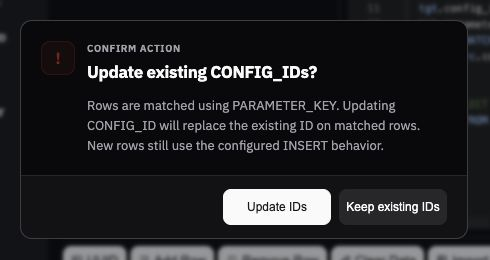

# Quick Query CONFIG_ID MERGE verification

Verified 2026-10-13 against the local Vite app using browser UI interactions.

## Result

- The toolbar has no CONFIG_ID option button.
- Every eligible MERGE generation opens **Update existing CONFIG_IDs?**.
- No automatic button or dialog focus highlight appears on opening. Tab still moves to a button with visible keyboard focus.
- **Keep existing IDs** omits `tgt.config_id = src.config_id` from the matched UPDATE.
- **Update IDs** includes that assignment.
- Both choices match on PARAMETER_KEY and retain CONFIG_ID in the INSERT branch.
- Escape dismisses the overlay and generates using Keep existing IDs.
- SQL was generated and inspected through Copy; it was not executed against Oracle.



## Reproduce

1. Run `npm run dev`, open the local app, and select Quick Query.
2. Use table `VERIFY.CONFIG` and query type MERGE INTO.
3. Enter these schema rows (tab-separated; field, type, nullability, default, order, PK):

```text
CONFIG_ID	NUMBER	No		1	Yes
PARAMETER_KEY	VARCHAR2(50)	No		2	
PARAMETER_VALUE	VARCHAR2(50)	Yes		3	
```

4. Sync Fields if needed. Enter `123`, `some.key`, and `new value` in the first data row.
5. Generate Query and choose Keep existing IDs. Copy the SQL and verify the matched assignment is absent while the INSERT ID remains.
6. Generate Query again: the overlay must reappear. Choose Update IDs and verify the matched assignment is present.
7. Generate again and verify there is no initial focus ring. Press Tab to verify keyboard focus, then Escape to retain IDs.

## Automated checks

- `./node_modules/.bin/vitest run frontend/tools/quick-query/tests`: 26 files, 321 tests passed.
- `./node_modules/.bin/vite build --outDir /tmp/ad-tools-config-id-build`: passed, with the existing large-chunk warning.
- Targeted ESLint: no errors; existing warnings remain in the Quick Query files.
- `git diff --check`: passed.

## UPDATE extension (2026-10-13)

Browser verified the same fixture with query type UPDATE, for both overlay choices.
Keep existing IDs omits CONFIG_ID from SET and from the changed-fields SELECT.
Update IDs includes it in both. WHERE still matches PARAMETER_KEY. The UPDATE
overlay omits the INSERT note and has no automatic focus highlight or toolbar button.
SQL was generated and copied, not executed against Oracle.

Reproduce by following the schema/data steps above, selecting UPDATE, and generating
once for each choice. The preserve-ID result is:

```sql
UPDATE VERIFY.CONFIG
SET
  parameter_value = 'new value'
WHERE parameter_key = 'some.key';

SELECT parameter_key, parameter_value FROM VERIFY.CONFIG
WHERE parameter_key IN ('some.key');
```

Focused regression command:

```sh
./node_modules/.bin/vitest run frontend/tools/quick-query/tests/config-id-merge.test.js frontend/tools/quick-query/tests/query-generation.test.js
```

Result: 2 test files, 112 tests passed.
